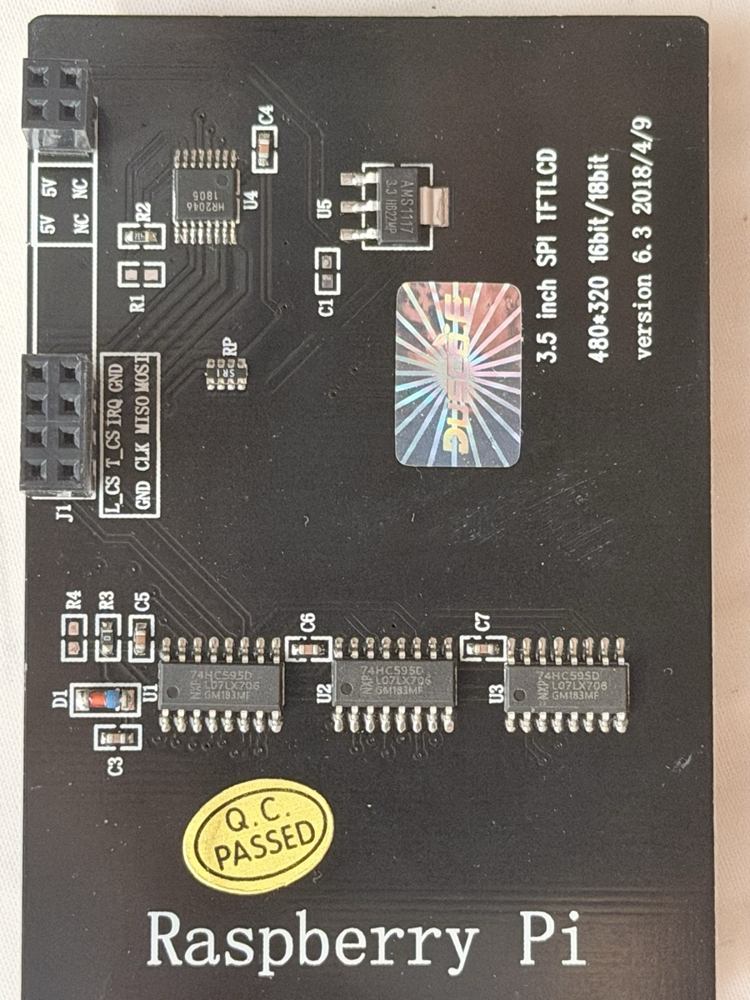
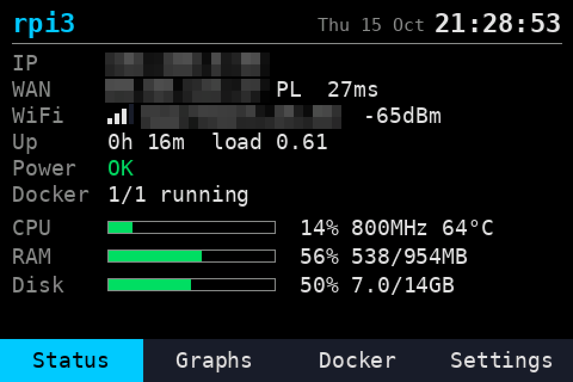

# kedei-lcd

Driver for the **KeDei 3.5" SPI TFT LCD v6.3** (480×320, resistive touch) on
**Raspberry Pi**, working on current Raspberry Pi OS (Debian 13 Trixie,
64-bit, kernel 6.x) without KeDei's patched 2019 kernel.

This display is sold on AliExpress/Amazon as "3.5 inch LCD TFT Touch Screen
Display for Raspberry Pi 2/3 + Acrylic Case + Stylus" (Dusco.E, KeDei and
others). It is **not** a Waveshare/ILI9486 clone: `piscreen`, `waveshare35a`,
`mhs35`, LCD-show and fbtft ILI9486 overlays all leave it with a **white
screen**. KeDei's own driver only exists as a replacement 4.19 kernel.

## Is this my display?

Look at the back of the board. It says:

```
3.5 inch SPI TFTLCD
480*320 16bit/18bit
version 6.3 2018/4/9
```

and carries three `74HC595` chips, an `HR2046` touch controller and an
`AMS1117` regulator. The header only has the SPI pins populated
(`L_CS T_CS IRQ GND / GND CLK MISO MOSI`, plus 5V).

<p align="center">
  
</p>

Boards marked `version 6.3 2016/11/1` look identical and probably work too,
but have not been tested.

## Tested hardware

Everything in this repository was tested on exactly this setup:

| | |
|---|---|
| Board | Raspberry Pi 3 Model B+ (Rev 1.3, BCM2837B0, 1 GB) |
| Display | KeDei 3.5" SPI TFTLCD, version 6.3 2018/4/9, panel id `0x10E2` |
| OS | Raspberry Pi OS Lite 64-bit, Debian 13 (trixie), image 2026-10-06 |
| Kernel | 6.18.50+rpt-rpi-v8 (aarch64) |
| Desktop mode | X.Org 1.21.1.16, openbox, tint2, pcmanfm |

Not tested: other Raspberry Pi models (the peripheral base address is
detected automatically, but SPI timing on a Pi 4 differs and the Pi 5 has a
different SPI controller), other KeDei versions (v6.0–v6.2 use different
init sequences and frame formats), 32-bit OS.

## Features

- Display: 480×320 RGB565, pushes only changed rows (~0.3 s per full frame).
- Touchscreen: X/Y/pressure, exposed as a standard input device
  (`KeDei Touch`, via `uinput`), works with a finger or the stylus.
- Two modes:
  - **ui** – lightweight touch UI with tabs:
    - *Status*: local and external IP, ping, Wi-Fi signal, uptime/load,
      power with the throttling cause (under-voltage or temperature limit),
      Docker, CPU load/clock/temperature, RAM and disk usage;
    - *Graphs*: last 30 minutes of CPU, temperature and network traffic;
    - *HA* (optional): Home Assistant tiles – states of lights, sensors,
      appliances, tap to toggle lights/switches or start a vacuum, see
      [Home Assistant page](#home-assistant-page);
    - *Docker* (when Docker is installed): containers with start/stop
      buttons (tap twice to confirm);
    - *Settings*: background color, refresh interval, night mode (dimmed
      colors on a schedule), screen off after inactivity, PIN lock with an
      on-screen keypad, warning thresholds, touch calibration and touch test
      (saved to `/etc/kedei-ui.conf`, PIN hash in `/etc/kedei-ui.pin`).
  - **desktop** – full display: the console and an X11 desktop are rendered
    into the system framebuffer and mirrored to the LCD; the touchscreen
    clicks and drags like a mouse.
- No kernel module, no DKMS: survives kernel upgrades.

<p align="center">
  
  <br><em>kedei-ui status page, captured from the frame sent to the LCD</em>
</p>

Video playback is not realistic: the board needs a separate 32-bit SPI frame
for every pixel, which limits a full-screen refresh to ~3 frames/s.

## Install

```sh
git clone https://github.com/kolomiichenko/kedei-lcd.git
cd kedei-lcd
sudo ./install.sh ui        # touch status UI
# or
sudo ./install.sh desktop   # console + X11 desktop on the LCD
```

The installer builds the driver, installs systemd services and disables
`dtparam=spi=on` if present (the driver needs SPI0 for itself). Reboot when it
asks to.

Switch between modes by running the installer with the other mode. Remove
everything with `sudo ./install.sh uninstall`.

## Touch calibration

In **ui** mode open the *Settings* tab and press *Calibrate touch*, then tap the
center of each of the 5 crosses. The result is saved to
`/etc/kedei-touch.conf` and applied immediately.

The file format is `xmin xmax ymin ymax swap_xy`: raw HR2046 values at the
left/right and top/bottom screen edges, `swap_xy=1` when raw Y follows the
screen X axis. The values from the tested board:

```
195 3983 3923 206 1
```

## Home Assistant page

The *HA* tab appears only when `/etc/kedei-ui.ha.json` exists. It shows up to
16 tiles (4 × 4) polled from the Home Assistant REST API every 3 s while the
tab is open.

1. In Home Assistant open your profile → *Security* → *Long-lived access
   tokens* and create one.
2. Save it on the Pi without putting it in the shell history:

   ```sh
   sudo sh -c 'umask 077; cat > /etc/kedei-ui.ha-token'   # paste, Enter, Ctrl-D
   ```

3. Copy [`ui/kedei-ui.ha.example.json`](ui/kedei-ui.ha.example.json) to
   `/etc/kedei-ui.ha.json`, put your entity ids in and run
   `sudo systemctl restart kedei-ui`.

Tile options:

| Key | Meaning |
|---|---|
| `entity` | entity id whose state is shown |
| `name` | label (default: the friendly name) |
| `tap` | `true` makes the tile a button: toggles `light`/`switch`/`fan`/`humidifier`/`input_boolean`/`automation`, runs a `scene`/`script`, starts a `vacuum` or sends it home |
| `sub` | second entity shown small in the corner, e.g. a battery or power sensor |
| `service`, `target` | button without an entity, e.g. `"service": "light.turn_off", "target": "all"` |

The PIN lock also covers this tab.

## HTTP API

`kedei-ui` listens on `127.0.0.1:8091` (change with `KEDEI_UI_API_PORT`):

| Request | Does |
|---|---|
| `GET /state` | CPU, temperature, memory, disk, power, current page, all settings with their options |
| `POST /settings` `{"night": "On", "sleep": 5}` | change settings (value or the label shown on the screen); the PIN lock is read-only |
| `POST /page` `{"page": "Graphs"}` | switch the page and wake the screen up |
| `POST /wake` | wake the screen up |

[`docs/home-assistant.yaml`](docs/home-assistant.yaml) turns it into Home Assistant
entities (screen settings as selects, Pi status as sensors) when Home Assistant
runs on the same Pi with host networking.

## How it works

`kedei-lcd` drives SPI0 and the GPIOs directly through `/dev/mem` and keeps a
shadow copy of the screen.

```
kedei-ui ──► /run/kedei/fb.raw ─┐
                                ├─► kedei-lcd ──► SPI0 ──► LCD
X11/console ──► /dev/fb0 ───────┘        │
                                         └──► uinput "KeDei Touch"
```

```sh
kedei-lcd test               # init and draw color bars
kedei-lcd daemon <source>    # source: raw 480x320 RGB565 file or /dev/fb0
```

Any program can draw on the screen by writing a 480×320 RGB565
little-endian frame (307200 bytes) to `/run/kedei/fb.raw` (write to a temp
file and rename it). The current touch state is also available as text in
`/run/kedei/touch`: `pressed x y raw_x raw_y pressure`.

The reverse-engineered protocol is documented in
[docs/PROTOCOL.md](docs/PROTOCOL.md), the design decision in
[docs/adr/0001-userspace-driver.md](docs/adr/0001-userspace-driver.md).

## Troubleshooting

- **White screen after install** – reboot once (kernel SPI must be off), then
  check `systemctl status kedei-lcd`. Run `sudo systemctl stop kedei-ui
  kedei-lcd && sudo kedei-lcd test` for color bars.
- **Picture flashes and turns white** – SPI clock too high. The default divider
  is 16; try `KEDEI_SPI_CDIV=20` in the service environment.
- **Touch is offset or mirrored** – run the calibration again.
- **Something else uses SPI** – this driver needs exclusive access to SPI0 and
  GPIO 7, 8, 9, 10, 11 and 25.

## Credits

The protocol was pieced together from KeDei's `LCD_show_v6_1_3` kernel and
earlier community work:

- [juj/fbcp-ili9341](https://github.com/juj/fbcp-ili9341) (`kedei_v6_3_mpi3501`
  branch and issue #40) – first v6.3 framing notes
- [lzto/FBTFT_KeDei_35_lcd_v62](https://github.com/lzto/FBTFT_KeDei_35_lcd_v62)
  – v6.2 init sequence
- [ykalchev/RaspberryPi_KeDei_35_lcd_v63](https://github.com/ykalchev/RaspberryPi_KeDei_35_lcd_v63)
- [saper-2/rpi-spi-lcd35-kedei](https://github.com/saper-2/rpi-spi-lcd35-kedei)
  – overview of all KeDei versions

## License

GPL-2.0, see [LICENSE](LICENSE).
